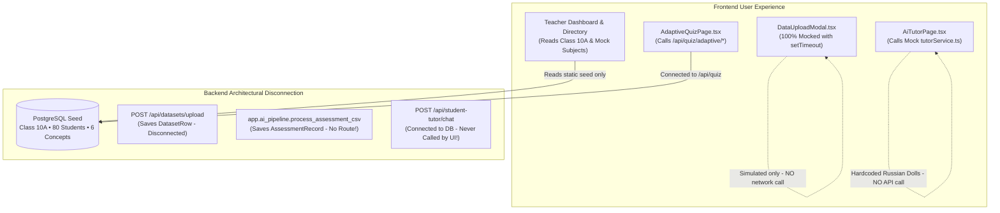
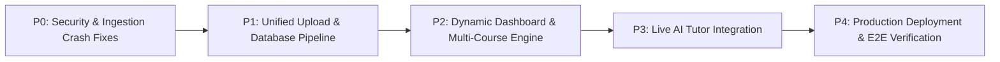

# AdaptiveClass AI — Full Backend and Frontend Integration Audit

**Date:** October 31, 2026 — 01:30 IST  
**Repository:** `adaptiveclass-ai`  
**Current Branch:** `integration/adaptiveclass-fullstack`  
**Audit Mode:** Strict Read-Only (Zero code or database modifications; all datasets unimported)  
**Verification Results:** Backend Pytest (94/94 passing), Frontend Build (`tsc -b && vite build` passing with 0 errors), Frontend Linter (`oxlint` completed with 0 errors, 6 warnings).

---

## 1. Executive Verdict

### How close is the application to being a real data-driven product?

**Current State: ~35% Real Data-Driven Engine / ~65% Calibrated Demonstration Sandbox.**

AdaptiveClass AI presents a clean, editorial user experience and includes well-engineered algorithmic building blocks—such as an automated assessment analysis pipeline, an emotion-aware Socratic tutor engine, and a calibrated PostgreSQL database. However, **in its current state, the system operates as a self-contained demonstration sandbox rather than a real data-driven learning platform**.



### The Three Architectural Disconnections
1. **The Ingestion Disconnection:** The frontend dataset upload modal (`DataUploadModal.tsx`) is entirely simulated using client-side timers (`setTimeout(..., 800)`). No network requests are made. In the backend, there are two separate dataset ingestion pipelines (`datasets.py` and `ai_pipeline.py`), neither of which writes to or updates the core `Class`, `Student`, `Concept`, or `ConceptPerformance` tables. PostgreSQL currently contains **0 uploaded datasets, 0 dataset rows, and 0 assessment records**.
2. **The Hardcoded Curriculum & Single-Class Limitation:** The Teacher Dashboard (`ClassOverviewPage.tsx`) and Subject Directory (`subjectService.ts`) read only one pre-seeded class from PostgreSQL (Class 10A: Data Structures, 80 students). Three of the four curriculum courses (DBMS, Operating Systems, Computer Networks) are **hardcoded mock objects** in the frontend. Key metrics like `recursion_support_count` are hardcoded into backend schemas (`schemas.py`) and analytics queries (`analytics_engine.py`).
3. **The AI Tutor Frontend/Backend Disconnect:** While a full backend Socratic tutor engine with emotion detection exists (`student_tutor.py`), the frontend AI Tutor workspace (`AiTutorPage.tsx`) delegates exclusively to a mock service (`tutorService.ts`) that returns static hardcoded responses (such as Russian nesting dolls for recursion).

---

## 2. Component & Feature Inventory Matrix

| Feature / Capability | Component / Endpoint | Classification | Evidence & Operational Status |
| :--- | :--- | :--- | :--- |
| **Teacher Authentication** | `auth.py` | **Implemented & Verified** | Returns JWT with `role="teacher"`. Captcha verification works when `login_id` is provided. |
| **Demo User Switching** | `auth.py` & `Navbar.tsx` | **Partially Implemented** | UI switches role in React state; does not invoke `/api/auth/login` or store JWT tokens. |
| **Demo State Calibration Reset** | `demo.py` | **Implemented & Verified** | Resets 80 students, 6 concepts, 480 concept performances, and clears quiz attempts. |
| **PostgreSQL Health & Connection** | `GET /api/health` | **Implemented & Verified** | Returns HTTP 200 `{"status": "healthy", "database": "postgresql"}`. |
| **Class Analytics API** | `classes.py` | **Implemented & Verified** | Computes live averages from `concept_performance` table for seeded Class 10A. |
| **Dataset Upload UI** | `DataUploadModal.tsx` | **Mocked or Hardcoded** | Uses `setTimeout(..., 800)` to simulate validation and import. Never calls the backend. |
| **Kartik's Dataset Upload API** | `POST /api/datasets/upload` | **Partially Implemented** | Parses single-sheet files into `dataset_rows`; **crashes on multi-sheet files** (reads `README`). |
| **Chhavi's AI/ML Assessment Pipeline** | `app.ai_pipeline.process_assessment_csv` | **Implemented but Unwired** | Full longitudinal analysis, alias matching, and pattern detection exist, but **lack any FastAPI route**. |
| **Excel Ingestion (School/College)** | `Datasets/*.xlsx` | **Broken or Risky** | `COLLEGE 1.xlsx` and `SCHOOL.xlsx` fail because active sheet is `README`. No chunked bulk inserts. |
| **Dynamic Database Generation** | Upload -> DB Pipeline | **Missing** | Uploading datasets does not create or update `Class`, `Student`, `Concept`, or `ConceptPerformance`. |
| **Curriculum Subject Directory** | `subjectService.ts` | **Mocked or Hardcoded** | Data Structures is live from DB; DBMS, OS, and Networks are 100% hardcoded mock objects. |
| **Student Roster & Profiles** | `StudentListPage.tsx` | **Implemented & Verified** | Fetches live student list from PostgreSQL; opens `StudentProfileModal` with live scores. |
| **Adaptive Quiz (Backend Engine)** | `quiz.py` & `analytics_engine.py` | **Implemented & Verified** | Evaluates answers, adjusts beginner/intermediate/advanced difficulty, and recalculates DB mastery. |
| **Adaptive Quiz (Frontend UI)** | `AdaptiveQuizPage.tsx` | **Implemented & Verified** | Successfully connected to `/api/quiz/adaptive/*` and updates database on submission. |
| **AI Tutor Frontend Workspace** | `AiTutorPage.tsx` | **Mocked or Hardcoded** | Connects to `tutorService.ts`. Uses hardcoded ELI5/step-by-step templates; ignores backend API. |
| **AI Tutor Backend API** | `POST /api/student-tutor/chat` | **Implemented but Unwired** | Emotion detection and Gemini/offline tutor work in tests/terminal, but are uncalled by frontend. |
| **Role-Based Access Control (RBAC)** | `dependencies.py` | **Broken or Risky** | Enforced on `/api/datasets` and `/api/student-tutor`, but **completely absent on `/api/quiz/*` and `/api/students/*`**. |
| **Database Migrations** | Database Lifecycle | **Missing** | No Alembic migrations exist. Relies entirely on `Base.metadata.create_all()` which cannot alter tables. |

---

## 3. Architecture & Data Flow

```
D:\PROGRAMMING\WebDev\AdaptiveClass AI\adaptiveclass-ai
├── Datasets/                               # 6 Synthetic Excel files (~231,000 total assessment rows)
├── backend/
│   ├── app/
│   │   ├── main.py                         # FastAPI entry point, lifespan, CORS, router registrations
│   │   ├── database.py                     # PostgreSQL connection pool (psycopg 3), Base, SessionLocal
│   │   ├── config.py                       # Environment variables, Gemini API keys, DB config
│   │   ├── models.py                       # 21 SQLAlchemy ORM models
│   │   ├── schemas.py                      # Pydantic request/response validation schemas
│   │   ├── security.py                     # JWT encoding/decoding, SHA-256 salted password hashing
│   │   ├── dependencies.py                 # Staff / student authentication bearer dependency guards
│   │   ├── seed_data.py                    # Calibrated 80-student mathematical seed script
│   │   ├── analytics_engine.py             # Class analytics, mastery calculations, quiz updates
│   │   ├── ai_insights.py                  # Gemini 2.5 Flash classroom insights + rule-based fallback
│   │   ├── ai_pipeline.py                  # Chhavi's unrouted assessment pipeline orchestrator
│   │   ├── csv_processor.py                # CSV header normalizer, alias resolver, boundary validator
│   │   ├── assessment_repository.py        # Atomic dataset and assessment record persistence in PostgreSQL
│   │   ├── performance_analyzer.py         # Statistical analysis, mastery distribution, gap detection
│   │   ├── pattern_detector.py             # Rule-based pedagogical pattern & learning bottleneck detector
│   │   ├── ai_service.py                   # Alternative dataset analysis & student AI generation
│   │   ├── routers/
│   │   │   ├── auth.py                     # /api/auth (login, captcha, demo-users)
│   │   │   ├── classes.py                  # /api/classes (list, analytics, students)
│   │   │   ├── datasets.py                 # /api/datasets (Kartik's upload, rows, analysis)
│   │   │   ├── demo.py                     # /api/demo (reset)
│   │   │   ├── quiz.py                     # /api/quiz (adaptive start, next-question, submit)
│   │   │   ├── students.py                 # /api/students (profile, recommendations)
│   │   │   ├── student_ai.py               # /api/student-ai (Kartik's alternate AI router)
│   │   │   └── student_tutor.py            # /api/student-tutor (Chhavi's AI tutor & adaptive practice)
│   │   └── student_ai/
│   │       ├── tutor.py                    # StudentTutor conversational engine (Gemini + offline fallback)
│   │       ├── emotion_detector.py         # Regex conversational emotion heuristic detector
│   │       ├── profiler.py                 # Learner profile builder and mastery tracker
│   │       ├── quiz_generator.py           # 3-tier adaptive quiz generator and offline question bank
│   │       ├── prompts.py                  # Socratic pedagogical system prompts & format directives
│   │       └── terminal_prototype.py       # Interactive terminal CLI prototype
│   └── tests/                              # 10 test modules (94 pytest tests)
└── frontend/
    └── src/
        ├── api.ts                          # Fetch API client (hardcoded to http://127.0.0.1:8000/api)
        ├── App.tsx                         # Root component, state management, top-level tab routing
        ├── components/
        │   ├── Navbar.tsx                  # Persona switcher, active tab navigation, demo reset
        │   ├── DataUploadModal.tsx         # Drag-and-drop upload modal (SIMULATED / MOCKED)
        │   ├── StudentProfileModal.tsx     # Student profile view modal
        │   ├── SubjectMasteryComparisonChart.tsx # CSS bar chart comparing subjects against 70% threshold
        │   ├── TopicMasteryHeatmap.tsx     # Diagnostic concept heatmap
        │   └── StudentScoreDistribution.tsx# 4-tier student count distribution
        ├── pages/
        │   ├── LandingPage.tsx             # Overview landing page with LetterGlitch canvas
        │   ├── ClassOverviewPage.tsx       # Primary instructor dashboard
        │   ├── SubjectDirectoryPage.tsx    # Multi-subject directory
        │   ├── SubjectReportView.tsx       # Individual subject report
        │   ├── StudentListPage.tsx         # 80-student roster
        │   ├── InsightsPage.tsx            # Learning gaps & priority actions
        │   ├── StudentDashboard.tsx        # Student portal (Aarav / Priya)
        │   ├── AiTutorPage.tsx             # 1-on-1 Socratic tutor (Calls mock tutorService.ts)
        │   ├── AdaptiveQuizPage.tsx        # 5-question adaptive practice (Calls /api/quiz)
        │   └── QuizResultsPage.tsx         # Results summary with closed feedback loop
        ├── services/
        │   ├── subjectService.ts           # Merges live DB subject with 3 hardcoded subjects
        │   └── tutorService.ts             # 100% Mock AI tutor service (Russian dolls, trees)
        └── types/                          # TypeScript interface definitions
```

---

## 4. Dataset Upload Findings & Schema Limitations

### Excel Ingestion Audit
Each of the 6 supplied Excel datasets was inspected for worksheet structure and row counts:

| Dataset File | File Size | Sheet Count | Target Data Sheet | Marks Records | Upload Result (`POST /api/datasets/upload`) |
| :--- | :---: | :---: | :--- | :---: | :--- |
| `COLLEGE 1.xlsx` | 8.9 MB | 14 | `student_marks` (Sheet 10) | 37,958 | **FAILS (HTTP 422)**: Reads sheet 1 (`README`), missing required columns. |
| `College_Dataset_2.xlsx` | 1.4 MB | 1 | `student_marks` (Sheet 1) | 37,082 | **FAILS (Memory/Timeout)**: 37k individual `db.add()` operations. |
| `College_Dataset_3.xlsx` | 1.4 MB | 1 | `student_marks` (Sheet 1) | 37,282 | **FAILS (Memory/Timeout)**: 37k individual `db.add()` operations. |
| `SCHOOL.xlsx` | 4.8 MB | 12 | `student_marks` (Sheet 10) | 36,813 | **FAILS (HTTP 422)**: Reads sheet 1 (`README`), missing required columns. |
| `School_Dataset_2.xlsx` | 1.3 MB | 1 | `student_marks` (Sheet 1) | 35,799 | **FAILS (Memory/Timeout)**: 37k individual `db.add()` operations. |
| `School_Dataset_3.xlsx` | 1.3 MB | 1 | `student_marks` (Sheet 1) | 36,229 | **FAILS (Memory/Timeout)**: 37k individual `db.add()` operations. |

### Major Technical Vulnerabilities in Ingestion:
1. **The Active Worksheet Defect (`datasets.py` L40-L47):**  
   The parser executes `sheet = workbook.active`. In `COLLEGE 1.xlsx` and `SCHOOL.xlsx`, openpyxl defaults to the first sheet: `README`. Because the README contains descriptive metadata instead of student marks, validation fails with `422 Unprocessable Entity: missing columns: assessment, class, date, marks, max_marks, name, roll_number, subject, topic`.
2. **Missing Bulk Insert Optimizations (`datasets.py` L140-L143):**  
   Iterating over ~37,000 rows with individual `db.add(DatasetRow(...))` creates 37,000 tracked ORM objects in Python memory, leading to high latency and database thread saturation.
3. **Gemini Prompt Token Overflow (`ai_service.py` L66-L71):**  
   `analyze_dataset` stringifies all dataset rows via `json.dumps(rows)` into the Gemini prompt:
   ```python
   prompt = "... Dataset rows: " + json.dumps(rows, default=str)
   ```
   For a 37,000-row spreadsheet, this produces **~7.5 MB of raw text**, causing immediate context window rejections or request timeouts.
4. **Relational Propagation Void:**  
   When a dataset is uploaded, rows are saved into `dataset_rows` or `assessment_records`. However, **no records are created in or linked to `students`, `classes`, `concepts`, or `concept_performance`**. Consequently, uploading a dataset leaves the Teacher Dashboard completely unchanged.

### Recommended Normalized Relational Model:
```mermaid
erDiagram
    INSTITUTION ||--o{ CLASS : offers
    TEACHER ||--o{ CLASS : instructs
    CLASS ||--o{ ENROLLMENT : contains
    STUDENT ||--o{ ENROLLMENT : enrolled_in
    COURSE ||--o{ TOPIC : defines
    CLASS }|--|| COURSE : teaches
    DATASET_UPLOAD ||--o{ RAW_DATASET_ROW : contains
    DATASET_UPLOAD ||--o{ ASSESSMENT_EVENT : generates
    ASSESSMENT_EVENT ||--o{ STUDENT_SCORE : records
    STUDENT ||--o{ STUDENT_SCORE : receives
    TOPIC ||--o{ STUDENT_SCORE : evaluates
    STUDENT_SCORE ||--o{ TOPIC_MASTERY_AGGREGATE : updates
```

- **`institutions`**: `id`, `name`, `type` (`school` | `college`).
- **`academic_terms`**: `id`, `institution_id`, `name`, `start_date`, `end_date`.
- **`courses`**: `id`, `code` (`CS101`, `MATH-09`), `name`, `institution_id`.
- **`topics`**: `id`, `course_id`, `name`, `sequence_order`.
- **`classes`**: `id`, `institution_id`, `term_id`, `course_id`, `teacher_id`, `name`.
- **`students`**: `id`, `institution_id`, `roll_number`, `name`, `email`.
- **`enrollments`**: `id`, `student_id`, `class_id`.
- **`dataset_uploads`**: `id`, `teacher_id`, `filename`, `file_hash`, `status`, `row_count`, `raw_storage_path`.
- **`raw_dataset_rows`**: `id`, `upload_id`, `row_index`, `raw_payload_json`, `validation_status`.
- **`assessment_events`**: `id`, `upload_id`, `class_id`, `course_id`, `topic_id`, `name`, `date`, `max_marks`.
- **`student_scores`**: `id`, `assessment_event_id`, `student_id`, `marks_obtained`, `percentage`.
- **`student_topic_mastery`**: `student_id`, `topic_id`, `mastery_score`, `assessments_taken`, `last_updated`.

---

## 5. Dashboard Data Provenance & Mock-Data Inventory

| Dashboard View | Metric / Element | Frontend Component | Backend Source | Provenance Classification |
| :--- | :--- | :--- | :--- | :--- |
| **Class Overview** | Cohort Size (`80 Students`) | `ClassOverviewPage.tsx` L38 | `GET /api/classes/{id}/analytics` | **Live from DB** (`COUNT(*)` from `students` table). |
| **Class Overview** | Overall Class Average (`59.2%`) | `analytics.overall_class_average` | `analytics_engine.py` L85 | **Live from DB** (Average of concept mastery across 80 seeded students). |
| **Class Overview** | Recursion Support Alert (`23 students`) | `analytics.recursion_support_count` | `analytics_engine.py` L88-L96 | **Live from DB, but Hardcoded Query** (`WHERE concept_name = 'Recursion' AND score < 40.0`). |
| **Class Overview** | Global Distribution (`12, 45, 18, 5`) | `StudentScoreDistribution.tsx` | `analytics_engine.py` L111-L121 | **Live from DB** (Calculated from 80 seeded students). |
| **Class Overview** | Subject Mastery Bars | `SubjectMasteryComparisonChart.tsx` | `subjectService.ts` L46-L226 | **Hybrid**: Data Structures is live from DB; DBMS (63.5%), OS (68.2%), and Networks (71.0%) are **hardcoded mock objects**. |
| **Class Overview** | Concept Mastery Heatmap | `TopicMasteryHeatmap.tsx` | `subject.topics` | **Hybrid**: 6 Data Structures topics are live from DB; 15 other topics are **hardcoded mock arrays**. |
| **Curriculum Directory** | All Courses List | `SubjectDirectoryPage.tsx` | `subjectService.getCurriculumSubjects()` | **Mocked**: 3 of 4 courses are static frontend objects. |
| **Student Roster** | Student Table (80 rows) | `StudentListPage.tsx` | `GET /api/classes/{id}/students` | **Live from DB** (Queries `students` table in PostgreSQL). |
| **Student Profile** | Scores, Radar, Quiz History | `StudentProfileModal.tsx` | `GET /api/students/{id}/profile` | **Live from DB** (Queries `concept_performance` and `quiz_attempts`). |
| **Insights & Actions** | Critical Bottleneck Banner | `InsightsPage.tsx` L92-L97 | Hardcoded JSX in component | **Hardcoded Constant**: `"Recursion Base Case Deficit (35.0%) ... 23 out of 80 students"`. |
| **Student Dashboard** | Header & Course Info | `StudentDashboard.tsx` L83 | Hardcoded JSX in component | **Hardcoded Constant**: `"Course: B.E. CSE — Data Structures • Semester 3"`. |

---

## 6. Student AI Tutor & Adaptive-Learning Findings

### Detailed Analysis:
1. **Frontend Disconnection:**  
   `AiTutorPage.tsx` (L92-L94) calls `tutorService.sendMessage`. This is an explicit mock layer running entirely in the browser using `setTimeout(resolve, 600)`. Selecting "Teach me like I'm five" returns pre-written text about Russian dolls for Recursion and family trees for Binary Trees.
2. **Backend Engine Architecture:**  
   `student_tutor.py` and `student_ai/` provide a full server-side implementation:
   - **Gemini Integration:** Targets `gemini-3.8-flash` via the `google.genai` SDK when `GEMINI_API_KEY` is present.
   - **Deterministic Fallback:** If the key is absent or a call fails, it provides pedagogical responses, ASCII memory diagrams, and pseudocode.
   - **Emotion Cue Detection:** `emotion_detector.py` uses regex patterns to detect confusion, frustration, nervousness, and confidence.
   - **Dynamic Scaffolding:** Difficulty escalates on correct answers (beginner $\rightarrow$ intermediate $\rightarrow$ advanced) and reinforces with simpler explanations on errors.
3. **Dual Adaptive Quiz Engine Conflict:**  
   The practice quiz on `AdaptiveQuizPage.tsx` calls `/api/quiz/adaptive/*` (`quiz.py`), while the newer student tutor module provides `/api/student-tutor/quiz/*` (`student_tutor.py` L233). They use conflicting mastery recalculation formulas:
   - `/api/quiz/submit` uses: $\text{New} = \text{round}(\text{Old} \times 0.35 + \text{Accuracy} \times 0.65, 1)$.
   - `/api/student-tutor/quiz/answer` uses: $\text{New} = \text{round}(\text{Old} \times 0.40 + \text{Accuracy} \times 0.60, 1)$.
4. **Security Vulnerabilities:**  
   - `/api/quiz/adaptive/start` and `/api/quiz/submit` require **no authentication**. Anyone can submit scores for any `student_id` and overwrite their database records.
   - Teachers have no authorized endpoint to view student-tutor transcripts or monitor learning hurdles.

---

## 7. Frontend-to-Backend Contract Audit

### Complete API Route Matrix

| Frontend UI Feature | HTTP & Requested Path | Actual FastAPI Route | Request Schema | Response Schema | Auth Required | Status |
| :--- | :--- | :--- | :--- | :--- | :---: | :--- |
| **Fetch Classes** | `GET /classes` | `GET /api/classes` | None | `List[ClassOut]` | None | **Connected** |
| **Class Analytics** | `GET /classes/{id}/analytics` | `GET /api/classes/{id}/analytics` | None | `ClassAnalyticsResponse` | None | **Connected** |
| **Attention Students** | `GET /classes/{id}/students-needing-attention` | `GET /api/classes/{id}/students-needing-attention` | None | `List[StudentNeedingAttentionItem]`| None | **Connected** |
| **Class Students** | `GET /classes/{id}/students` | `GET /api/classes/{id}/students` | None | `List[StudentRosterItem]` | None | **Connected** |
| **Student Profile** | `GET /students/{id}/profile` | `GET /api/students/{id}/profile` | None | `StudentProfileResponse` | None | **Connected** |
| **Recommendations** | `GET /students/{id}/recommendations` | `GET /api/students/{id}/recommendations` | None | `StudentRecommendation` | None | **Connected** |
| **Demo Reset** | `POST /demo/reset` | `POST /api/demo/reset` | None | `{"status": "success", ...}` | None | **Connected** |
| **Start Quiz** | `POST /quiz/adaptive/start` | `POST /api/quiz/adaptive/start` | `AdaptiveStartRequest` | `AdaptiveStartResponse` | None | **Connected** |
| **Next Question** | `POST /quiz/adaptive/next-question` | `POST /api/quiz/adaptive/next-question` | `AdaptiveNextQuestionRequest` | `AdaptiveNextQuestionResponse` | None | **Connected** |
| **Submit Quiz** | `POST /quiz/submit` | `POST /api/quiz/submit` | `QuizSubmitRequest` | `QuizSubmitResponse` | None | **Connected** |
| **Upload Modal** | *None (Simulated)* | `POST /api/datasets/upload` | `multipart/form-data` | `DatasetUploadDetailResponse` | Teacher/Mentor | **Mocked in UI** |
| **AI Tutor Chat** | *None (Mock Service)* | `POST /api/student-tutor/chat` | `TutorChatRequest` | `TutorChatResponse` | Student Bearer | **Mocked in UI** |
| **Tutor Practice** | *None (Mock Service)* | `POST /api/student-tutor/quiz/start`| `TutorQuizStartRequest`| `TutorQuizStartResponse` | Student Bearer | **Mocked in UI** |
| **Teacher Login** | `POST /auth/login` (in `api.ts`) | `POST /api/auth/login` | `LoginRequest` | `LoginResponse` | None | **Unused by UI** |
| **Demo Users** | `GET /auth/demo-users` (in `api.ts`)| `GET /api/auth/demo-users` | None | `List[DemoUser]` | None | **Unused by UI** |
| **Chhavi's ML Pipeline**| *None (No Route)* | *Unrouted Function* | `bytes, teacher_id` | Pipeline Dict | Teacher | **Missing Route** |

### Networking Defects:
- **Hardcoded Endpoint URL (`api.ts` L11):** `const API_BASE = 'http://127.0.0.1:8000/api';` ignores Vite environment variables (`import.meta.env.VITE_API_URL`).
- **CORS Conflict (`main.py` L49-L54):** `allow_origins=["*"]` combined with `allow_credentials=True` violates browser CORS specifications.
- **Missing Token Injection (`api.ts` L13-L32):** `request<T>` never attaches `Authorization: Bearer <token>`, causing protected routes to fail with HTTP 401.

---

## 8. Database, Authentication & Security Risks

1. **Insecure Password Hashing (`security.py` L25-L32):** Uses unsalted/static-salted SHA-256 (`SALT = "adaptive_edu_salt_"`), vulnerable to rainbow table attacks.
2. **Environment Variable Naming Bug:** `.env.example` (L16) documents `SECRET_KEY`, but `security.py` (L15) looks for `JWT_SECRET_KEY`. When configured as documented, it silently defaults to `"adaptiveclass-ai-development-only-key"`.
3. **Missing Authorization:** `/api/students/{id}/profile` and `/api/quiz/submit` do not verify caller identity, allowing unauthorized access and score forgery.
4. **No Database Migrations:** Relies on `Base.metadata.create_all()`, which cannot alter existing tables, columns, or constraints when models change.

---

## 9. Tests Actually Run & Their Results

### 1. Backend Pytest Execution
- **Command:** `.\.venv\Scripts\python.exe -m pytest tests/ -v`
- **Result:** **94 passed, 3 deprecation warnings in 2.91s (100% pass rate)**.
- **Test Composition:**
  - 89 unit tests run against **in-memory SQLite** (`sqlite:///:memory:`).
  - 5 integration tests (`test_api_endpoints.py`, `test_seed_calibration.py`) run against the **seeded PostgreSQL database** (`adaptive_db`).
  - No tests cover multi-sheet Excel extraction, 37,000-row file parsing, or Gemini prompt token limits.

### 2. Standalone Verification Scripts
- `python test_real_csv.py` — **Passed (Exit code 0)**.
- `python test_performance.py` — **Passed (Exit code 0)**.

### 3. Frontend Build & Quality Checks
- **Command:** `npm run build` (`tsc -b && vite build`) — **Passed (Exit code 0 in 1.71s)**.
- **Command:** `npm run lint` (`oxlint`) — **Passed with 0 errors, 6 warnings** (flags synchronous state setters in `useEffect` and impure `Date.now()` during render).

---

## 10. Prioritized Implementation Roadmap



### Phase P0: Data Integrity, Security & Blocking Failures
1. **Fix Multi-Sheet Excel Parsing & Sheet Selection**
   - **File:** `backend/app/routers/datasets.py` (L40-L47)
   - **Fix:** Search `workbook.sheetnames` for `student_marks`, `marks`, or `assessments`; do not default blindly to `workbook.active`.
2. **Correct Environment Variable Mismatch for JWT Secret**
   - **File:** `backend/app/security.py` (L15)
   - **Fix:** Check `os.getenv("JWT_SECRET_KEY") or os.getenv("SECRET_KEY")`.
3. **Upgrade Password Hashing to Passlib Bcrypt**
   - **File:** `backend/app/security.py` (L25-L33)
   - **Fix:** Replace SHA-256 with `passlib.context.CryptContext(schemes=["bcrypt"])`.
4. **Enforce Student Authentication on Quiz Endpoints**
   - **File:** `backend/app/routers/quiz.py` (L19, L71, L126)
   - **Fix:** Inject `current_student = Depends(get_authenticated_student)` and verify `req.student_id == current_student.id`.

### Phase P1: Reliable Upload & Persistent Database Integration
1. **Unify Duplicate Ingestion Pipelines**
   - **Files:** `backend/app/routers/datasets.py` and `backend/app/ai_pipeline.py`
   - **Fix:** Consolidate into a single pipeline utilizing `csv_processor.py` for alias mapping and persisting to normalized schema tables.
2. **Implement Chunked Streaming & Bulk Database Inserts**
   - **File:** `backend/app/assessment_repository.py` (L57-L82)
   - **Fix:** Replace individual `db.add()` loops with `db.bulk_insert_mappings()` in 1,000-row chunks.
3. **Connect Frontend Upload Modal to Backend Upload API**
   - **File:** `frontend/src/components/DataUploadModal.tsx` (L73-L86)
   - **Fix:** Replace `setTimeout` simulation with real `multipart/form-data` upload request to `/api/datasets/upload`.
4. **Propagate Uploaded Assessment Records to Core Student Entities**
   - **File:** `backend/app/ai_pipeline.py`
   - **Fix:** Automatically enroll new students and update `concept_performance` weighted mastery upon file import.

### Phase P2: Real Analysis & Teacher Dashboard
1. **Remove Hardcoded Curriculum Subjects**
   - **File:** `frontend/src/services/subjectService.ts` (L78-L226)
   - **Fix:** Dynamically generate course cards from database classes and subjects.
2. **Eliminate Hardcoded "Recursion" Metrics**
   - **Files:** `backend/app/schemas.py` (L138) and `backend/app/analytics_engine.py` (L88-L96)
   - **Fix:** Replace hardcoded `recursion_support_count` with dynamic `priority_gap_concept` and `priority_gap_count`.
3. **Resolve Gemini Prompt Token Overflow**
   - **File:** `backend/app/ai_service.py` (L60-L72)
   - **Fix:** Compute statistical aggregations locally and send only compact summary metrics to Gemini.

### Phase P3: Adaptive Student Tutor Integration
1. **Connect Frontend AI Tutor to Backend API**
   - **Files:** `frontend/src/pages/AiTutorPage.tsx` (L92-L95) and `frontend/src/services/tutorService.ts`
   - **Fix:** Connect message input to `POST /api/student-tutor/chat`.
2. **Add Teacher Oversight for Student Tutor Conversations**
   - **File:** `backend/app/routers/student_tutor.py`
   - **Fix:** Create `GET /api/student-tutor/teacher/summary/{class_id}` for aggregated confusion patterns.
3. **Consolidate Adaptive Quiz Engines**
   - **Files:** `backend/app/routers/quiz.py` and `backend/app/student_ai/quiz_generator.py`
   - **Fix:** Standardize on a unified mastery update formula across practice quizzes and tutor assessments.

### Phase P4: Deployment Readiness & Automated Testing
1. **Parameterize Frontend Base URL**
   - **File:** `frontend/src/api.ts` (L11)
   - **Fix:** Use `import.meta.env.VITE_API_URL || 'http://127.0.0.1:8000/api'`.
2. **Resolve CORS Specification Conflict**
   - **File:** `backend/app/main.py` (L48-L55)
   - **Fix:** Replace `allow_origins=["*"]` with explicit `allow_origins=CORS_ORIGINS`.
3. **Add End-to-End Test Suite**
   - **Directory:** `backend/tests/`
   - **Fix:** Add automated tests covering the full cycle: file upload $\rightarrow$ parsing $\rightarrow$ PostgreSQL storage $\rightarrow$ dashboard re-calculation.

