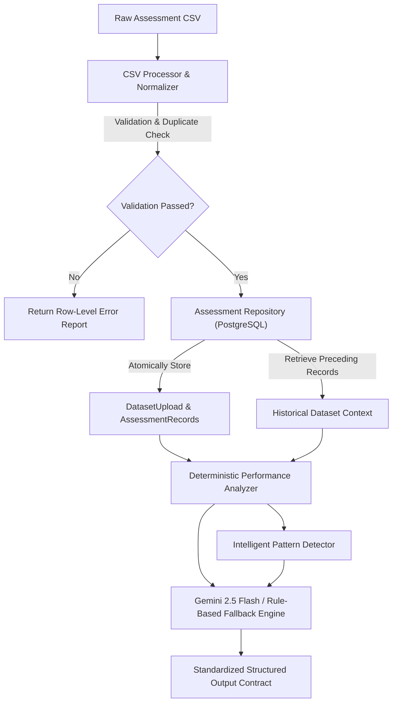

# 🧠 AdaptiveClass AI — Teacher Portal AI/ML Intelligence Pipeline

## 1. Overview & Purpose
This module provides the complete, independent data ingestion, validation, deterministic performance analytics, pattern detection, and Gemini-powered instructional intelligence pipeline for the AdaptiveClass Teacher Portal.

The pipeline processes raw classroom assessment datasets (CSV format), stores validated records in PostgreSQL with strict teacher ownership and dataset isolation, calculates rigorous pedagogical metrics (class, student, subject, topic, and historical levels), identifies learning gaps and empirical trends, and synthesizes actionable teaching interventions.

---

## 2. Architecture & Data Flow



---

## 3. Required CSV Format & Column Aliases

Assessments must include the following 9 standard columns:

| Standard Key | Required | Description | Accepted Column Header Aliases |
| :--- | :---: | :--- | :--- |
| `rollno` | **Yes** | Primary Student Identifier | `rollno`, `roll_no`, `roll_number`, `student_id`, `roll`, `reg_no`, `enrollment_no` |
| `name` | **Yes** | Student Name | `name`, `student_name`, `student`, `full_name`, `candidate_name` |
| `subject` | **Yes** | Subject / Course | `subject`, `course`, `subject_name`, `course_name` |
| `class` | **Yes** | Class / Grade / Cohort | `class`, `class_name`, `grade`, `section`, `cohort` |
| `marks` | **Yes** | Marks Obtained ($0 \le \text{marks} \le \text{max\_marks}$) | `marks`, `score`, `obtained_marks`, `marks_obtained`, `obtained`, `scored_marks` |
| `max_marks` | **Yes** | Maximum Marks ($> 0$, **never defaulted**) | `max_marks`, `total_marks`, `maximum_marks`, `out_of`, `max_score` |
| `topic` | **Yes** | Specific Curriculum Topic | `topic`, `chapter`, `unit`, `concept`, `subtopic`, `lesson` |
| `assessment` | **Yes** | Assessment Title | `assessment`, `test`, `exam`, `exam_name`, `assessment_name`, `quiz` |
| `date` | **Yes** | Date (YYYY-MM-DD or DD-MM-YYYY) | `date`, `assessment_date`, `exam_date`, `test_date`, `attempt_date` |

### Sample Synthetic CSV:
```csv
rollno,name,subject,class,marks,max_marks,topic,assessment,date
101,Aarav Sharma,Data Structures,CSE-A,8,20,Recursion,Quiz 1,2026-10-10
102,Diya Patel,Data Structures,CSE-A,18,20,Recursion,Quiz 1,2026-10-10
103,Rohan Verma,Data Structures,CSE-A,14,20,Recursion,Quiz 1,2026-10-10
```

---

## 4. How the Backend Team Can Call the Pipeline

The public entry point is [`app.ai_pipeline`](file:///C:/Users/Lenovo/.gemini/antigravity/worktrees/adaptiveclass-ai/untitled-worktree/backend/app/ai_pipeline.py).

### Method A: End-to-End Processing from CSV
```python
from app.ai_pipeline import process_assessment_csv

result = process_assessment_csv(
    file_content=uploaded_file_bytes_or_string,
    teacher_id=current_teacher.id,
    db=db_session,                              # Optional: set to None for stateless execution
    filename="midterm_assessment.csv",          # Optional metadata
    column_mapping={"rollno": "RegNumber"}      # Optional explicit override
)

if result["status"] == "success":
    print("Class Average:", result["class_analytics"]["overall_average"])
    print("AI Summary:", result["ai_insights"]["class_summary"])
else:
    print("Validation Errors:", result["validation_results"]["row_errors"])
```

### Method B: Analyze an Existing Stored Dataset
```python
from app.ai_pipeline import analyze_existing_dataset

result = analyze_existing_dataset(
    dataset_id=12,
    teacher_id=current_teacher.id,
    db=db_session
)
```

### Method C: Longitudinal Historical Trend Analysis Across Uploads
```python
from app.ai_pipeline import retrieve_historical_analysis

history = retrieve_historical_analysis(
    teacher_id=current_teacher.id,
    db=db_session,
    class_name="CSE-A",
    subject="Data Structures"
)
```

---

## 5. Standardized Structured Output Contract

The pipeline returns a clean, fully-typed dictionary:

```json
{
  "status": "success",
  "message": "Assessment data processed and analyzed successfully.",
  "dataset_metadata": {
    "dataset_id": 1,
    "filename": "quiz_1.csv",
    "teacher_id": 3,
    "class_name": "CSE-A",
    "subject": "Data Structures",
    "assessment_name": "Quiz 1",
    "total_records": 3,
    "valid_records": 3,
    "duplicate_records": 0,
    "upload_timestamp": "2026-10-30T11:00:00Z"
  },
  "validation_results": {
    "total_rows": 3,
    "accepted_rows": 3,
    "rejected_rows": 0,
    "duplicate_rows": 0,
    "row_errors": [],
    "column_mapping": { "rollno": "rollno", "marks": "marks", "...": "..." }
  },
  "class_analytics": {
    "overall_average": 66.67,
    "median_average": 70.0,
    "highest_score": 90.0,
    "lowest_score": 40.0,
    "student_count": 3,
    "assessment_records_count": 3,
    "performance_distribution": {
      "advanced": 1,
      "proficient": 1,
      "developing": 0,
      "needs_support": 1,
      "total": 3
    },
    "students_needing_support": [
      {
        "rollno": "101",
        "name": "Aarav Sharma",
        "average": 40.0,
        "weaknesses": ["Recursion"]
      }
    ],
    "learning_gaps": ["Recursion (40.0%, 1 students struggling)"],
    "strongest_topic": "Recursion",
    "weakest_topic": "Recursion"
  },
  "student_analytics": [
    {
      "rollno": "102",
      "name": "Diya Patel",
      "average_percentage": 90.0,
      "learning_level": "Advanced",
      "subject_performance": { "Data Structures": 90.0 },
      "topic_performance": { "Recursion": 90.0 },
      "strengths": ["Recursion"],
      "weaknesses": []
    }
  ],
  "subject_analytics": [
    {
      "name": "Data Structures",
      "percentage": 66.67,
      "level": "Developing",
      "students_count": 3,
      "revision_needed": true
    }
  ],
  "topic_analytics": [
    {
      "name": "Recursion",
      "percentage": 66.67,
      "level": "Developing",
      "revision_priority": "critical",
      "struggling_students_count": 1,
      "struggling_students_percentage": 33.3
    }
  ],
  "pattern_detection": [
    {
      "pattern_type": "CRITICAL_LEARNING_GAP",
      "entity_name": "Recursion",
      "priority": "high",
      "evidence": "Topic average is 40.0%. 1 of 3 students (33.3%) scored below 50%.",
      "rule": "Topic average < 40% or struggling students >= 30%",
      "recommended_action": "Schedule an immediate revision session for 'Recursion'."
    }
  ],
  "historical_comparison": {
    "has_historical_data": true,
    "class_average_change": 16.66,
    "persistent_weak_topics": [],
    "improving_students": [{ "rollno": "101", "name": "Aarav Sharma", "change": 40.0 }],
    "declining_students": []
  },
  "ai_insights": {
    "class_summary": "Classroom overall average is 66.67% across 3 assessed students. 1 student(s) demonstrated advanced mastery (>=85%), while 1 student(s) currently fall below the 50% academic proficiency threshold.",
    "student_support_recommendations": [
      {
        "student": "Aarav Sharma (101)",
        "gap": "Recursion",
        "evidence": "Average score 40.0%",
        "suggested_action": "Provide structured remediation and foundational exercises in Recursion."
      }
    ],
    "topic_recommendations": [
      {
        "topic": "Recursion",
        "issue": "33.3% of students scored below 50% (topic average 66.67%)",
        "teaching_strategy": "Conduct an interactive tracing/worked-example review focusing on Recursion core concepts.",
        "practice_activity": "Assign 3-5 progressive exercises starting with beginner constraints before multi-step applications."
      }
    ],
    "historical_insights": "Class performance has increased by 16.66 percentage points between assessments. 1 student(s) showed significant improvement (>=+10%).",
    "actionable_teaching_recommendations": [
      "Prioritize dedicated classroom revision on high-barrier topics: Recursion.",
      "Organize small-group tutoring for the 1 students scoring below 50%."
    ],
    "generated_by": "Autonomous Rule-Based Engine",
    "teacher_disclaimer": "AI-generated insights are recommendations. Teachers remain in control of instructional decisions."
  }
}
```

---

## 6. How Validation & Error Handling Works

- **Zero Fabricated Data**: Missing values (`marks`, `max_marks`, `rollno`, `date`) immediately fail validation and append to `row_errors`.
- **No Inferred Max Marks**: Maximum marks are strictly validated $> 0$ and **never** defaulted to 100.
- **Boundary Checks**: Negative marks and marks exceeding maximum marks are flagged with row numbers.
- **Duplicate Prevention**: Composite key `(rollno, subject, topic, assessment, date)` detects and drops duplicates, reporting the count in `duplicate_rows`.
- **Database Safety**: All database insertions happen inside an atomic transaction. Any error triggers automatic rollback.

---

## 7. How to Execute Tests

Run the dedicated test suite:
```powershell
# Set PYTHONPATH and run pipeline tests
$env:PYTHONPATH="backend"
pytest backend/tests/test_ai_ml_pipeline.py -v
```

Run existing regression tests:
```powershell
pytest backend/tests/test_ai_fallback.py -v
python backend/test_performance.py
```

---

## 8. Configuration & Limitations

- **PostgreSQL Connection**: Configured via `DATABASE_URL` in `backend/.env`. The pipeline automatically runs with PostgreSQL in production, and supports in-memory SQLite for isolated test environments.
- **Gemini API Key**: Set `GEMINI_API_KEY` in `backend/.env`. If omitted, expired, or unavailable, the system transparently utilizes the built-in deterministic rule-based engine with 0ms latency and zero downtime.
- **Frontend Integration**: UI connection is handled by the backend and frontend teams via FastAPI routes calling `app.ai_pipeline.process_assessment_csv` and `app.ai_pipeline.analyze_existing_dataset`.
